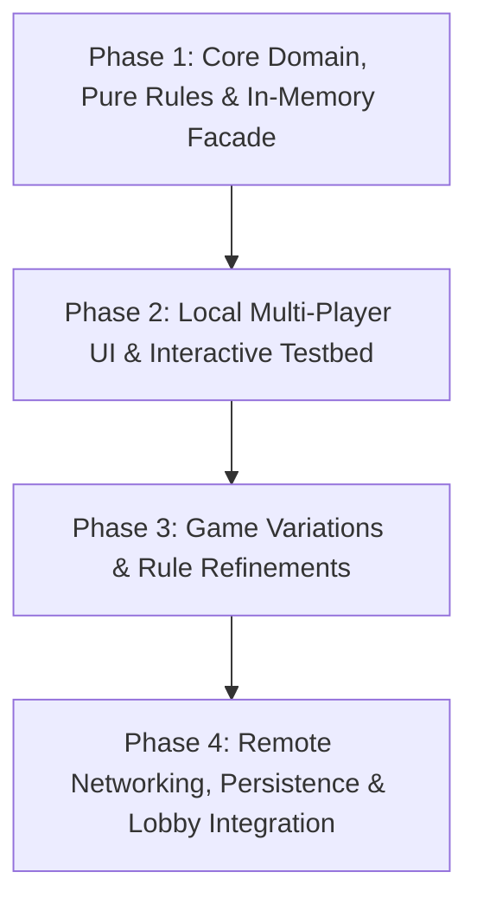

# Tricks Game Plan & Generic Arena Architecture

## 1. Objectives & Overview

1. **Add "Tricks" game**: Introduce a trick-taking card game named `tricks` (package `cz.kotu.game.tricks`), sitting alongside `contacts` and `gotfive`.
2. **Abstract & Adaptable Foundation**: Support variations on trick-taking games (e.g. *The Crew: Deep Sea*, *The Lord of the Rings: Trick-Taking Game*). 
   - Keep models abstract and modular: card ranks as typed numbers (e.g. 1–9), color-based or customizable suits, easy to refactor or extend with trump/mission rules.
3. **UI-First & Local Multiplayer Testbed**:
   - Rather than jumping straight to networking and DB persistence, build an in-process local multiplayer testbed (inspired by `MultiPlayerScreen.kt`) so players can be tested side-by-side locally.
   - Postpone server endpoints, SSE, and Room DB persistence until core rules and UI interaction are proven.
4. **Explore Generic Arena Boundaries**: Compare how game state, sanitization, facades, and UI are wired vs. Contacts to discover reusable abstractions.
5. **Iterative & Testable Delivery**: Deliver in small, reviewable commits with automated tests at every step.

---

## 2. Card & Domain Model Design

### Flexible Trick-Taking Abstraction
- **`Rank`**: Typed integer (e.g., `1..9`). Can easily represent card values in modern games like *The Crew* or standard card ranks.
- **`Suit`**: Enum or value class with color identifiers (e.g., `Blue`, `Green`, `Yellow`, `Pink`/`Red`), plus an optional `Trump` / `Special` suit (e.g. `Black` / Rockets).
- **`Card`**: `data class Card(val suit: Suit, val rank: Rank)`.
- **`Trick`**: Ordered list of played cards with the player ID who played each card:
  - `leadSuit`: suit of the first card played in the trick.
  - `plays`: list of `(playerId, card)`.
- **`TrickRules`**: Pluggable evaluation:
  - Follow-suit validation: if a player holds a card matching `leadSuit`, they must play a card of `leadSuit`.
  - Trick winner determination: highest trump card wins; if no trumps, highest card of `leadSuit` wins.
- **`TricksPlayer`**: ID, username, and private hand of cards.
- **`TricksGameState`**: Roster of players, current round/trick, completed tricks, tricks won by each player, current turn player, game phase.

### Data Sanitization (`TricksPlayerViewState`)
- **Public**: Completed tricks, current active trick cards, trump suit, player scores/tricks won, current turn indicator.
- **Private**: Active player's own cards in hand. Opponents' hands are sanitized to only reveal `cardCount`.

---

## 3. Implementation Phases

### Phase 1: Core Domain, Pure Rules & In-Memory Facade (`core`)
- [x] Create package `cz.kotu.game.tricks.model`.
- [x] Define `Suit`, `Rank`, `Card`, `Trick`, `TricksPlayer`, and `TricksGameState`.
- [x] Implement pure rules & reducers:
  - Deck generation and deal logic for 2–4 players.
  - Follow-suit validation (`isPlayLegal(state, player, card)`).
  - Trick resolution & winner evaluation.
  - Turn rotation to next player or trick winner.
- [x] Define `TricksPlayerViewState` with opponent card masking.
- [x] Implement `TricksGameFacade` and `TricksGameFacadeImpl` (in-memory state flow + actions).
- [x] Implement `TricksPlayerGameAdapter` to provide player-scoped view state.
- [x] Add unit tests in `core/src/commonTest/kotlin/cz/kotu/game/tricks/model/...`:
  - Follow-suit rule enforcement (legal vs illegal plays).
  - Trick winner determination with and without trumps.
  - Dealing and hand-size consistency.
  - Opponent hand sanitization.

### Phase 2: Local Multi-Player UI & Interactive Testbed (`app/shared`)
- [x] Create `TricksPlayerScreen`:
  - Active trick area displaying cards on table.
  - Player's hand with clear visual cards (colored suit + rank number) and clickable interaction for legal cards.
  - Status header: active turn, trump suit indicator, trick counter.
- [x] Create `TricksPlayerViewModel` backed by `TricksPlayerFacade`.
- [x] Create `TricksMultiPlayerScreen` / debug entry:
  - Renders 2–4 player views side-by-side or switchable locally on one screen.
  - Allows full interactive play without server, network, or auth dependencies.
- [ ] User testing & feedback on card feel, layout, and gameplay flow.

### Phase 3: Game Variations & Rule Refinements (`core` + `app/shared`)
- [ ] Refine trick-taking rules based on desired game style (e.g. cooperative mission goals like *The Crew*, or specific trick objectives like *LOTR*).
- [ ] Polish UI, card styling, and animations.

### Phase 4: Remote Networking, Persistence & Lobby Integration (`server` + `core` + `app/shared`)
- [ ] Extend `RunningGameStatus` and `CreateGameRequest` for Tricks.
- [ ] Add `TricksGame : ManagedGame` in server and persistence in Room DB.
- [ ] Implement server routes `/api/games/{gameId}/tricks/...` (events SSE, actions POST).
- [ ] Implement `NetworkTricksGameFacade` for client-server play.
- [ ] Integrate into `GamesScreen` lobby and `App.kt` navigation.

---

## 4. Generic Arena Insights Log

*(To be updated as implementation progresses)*
- **Local vs Remote Facade**: Both Contacts and Tricks benefit from having a pure in-memory `GameFacadeImpl` and `PlayerGameAdapter` that can run locally in tests and local split-screen UI before any network code is touched.
- **Client View Sanitization**: Just as Contacts has `PlayerViewState`, Tricks has `TricksPlayerViewState` where cards in opponents' hands are replaced with count-only representations.
